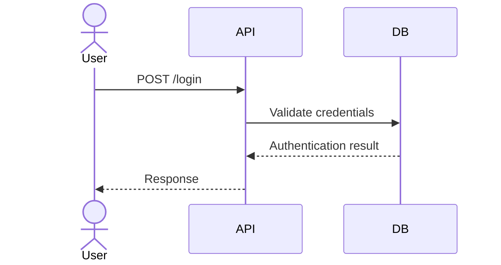

# Black-s
This repo be used to place the files will be cited!
# Creating Publication-Quality Technical Figures

> <span style="color:#176B87;"><strong>Purpose:</strong></span> A practical guide to planning, drawing, validating, and exporting circuit schematics, timing diagrams, waveforms, and sequence diagrams for technical articles.
>
> <span style="color:#7A4E00;"><strong>Audience:</strong></span> Engineers, researchers, technical writers, and students preparing figures for papers, reports, presentations, or documentation.
>
> <span style="color:#8A3A3A;"><strong>Important:</strong></span> Journal and conference instructions take precedence over every general recommendation in this guide.

Professional figures are not decoration. They are part of the technical argument: a reader should be able to understand the system, verify the stated relationships, and locate the evidence without guessing. The strongest figures combine **technical correctness**, **clear visual hierarchy**, **accessible encoding**, and **reproducible source files**.

---

## Contents

1. [Start with the message](#1-start-with-the-message)
2. [Choose the right diagram](#2-choose-the-right-diagram)
3. [Circuit schematics](#3-circuit-schematics)
4. [Waveforms and timing diagrams](#4-waveforms-and-timing-diagrams)
5. [Sequence diagrams](#5-sequence-diagrams)
6. [Visual design and accessibility](#6-visual-design-and-accessibility)
7. [Tools and output formats](#7-tools-and-output-formats)
8. [A reproducible figure workflow](#8-a-reproducible-figure-workflow)
9. [Export and submission checklist](#9-export-and-submission-checklist)
10. [Common problems and fixes](#10-common-problems-and-fixes)
11. [Further reading](#11-further-reading)

## 1. Start with the message

Before opening a drawing tool, write down what the figure needs to prove or explain. A useful one-sentence brief is:

> **This figure helps [reader] understand [one main relationship or process] by showing [the essential evidence].**

Then decide:

1. **Audience:** What does the intended reader already know?
2. **Purpose:** Is the figure explaining architecture, documenting an electrical connection, comparing data, or showing event order?
3. **Scope:** Which details are necessary to support the message? Which can move to the caption or supplementary material?
4. **Evidence:** Are values measured, simulated, calculated, or illustrative? Label them accurately.
5. **Destination:** Will the figure appear in a paper, a slide, a web page, or a printed report? The final size and rendering environment affect every design decision.

<span style="color:#176B87;"><strong>Rule of thumb:</strong></span> If a reader needs the figure to make a decision, do not encode essential information only in color, hover text, or a caption far away from the figure.

## 2. Choose the right diagram

Use a representation that matches the question. A diagram can be visually attractive and still be the wrong one for the job.

| Reader's question | Suitable figure | What it should make clear |
|---|---|---|
| Which components are electrically connected? | Circuit schematic | Components, pins, nets, reference designators, and relevant values |
| How do digital signals change over time? | Timing diagram | Signal levels, transitions, bus values, clock relationship, and timing intervals |
| What does a measured or simulated signal look like? | Waveform plot | Axes, units, sampling or time range, data meaning, and uncertainty where relevant |
| Which actor sends which message, and when? | Sequence diagram | Participants, message direction, ordering, conditions, and repeated interactions |
| How is a system divided into functional blocks? | Block diagram | Components or subsystems, interfaces, and the direction or meaning of connections |

Do not substitute a decorative block diagram for a schematic when a reader must reproduce the electrical connectivity. Similarly, a sequence diagram shows message order; it does not, by itself, establish timing or performance.

## 3. Circuit schematics

### 3.1 Design for unambiguous connectivity

A schematic should let a technically qualified reader trace the circuit without interpreting visual guesswork.

- Use symbols and conventions appropriate to the field and the target publication. Check the applicable IEEE, IEC, or other discipline-specific standard when compliance matters.
- Give components unique reference designators, such as `R1`, `C2`, and `U3`, and include values when they matter to the explanation.
- Label meaningful nets, pins, supplies, grounds, inputs, and outputs. Use consistent names throughout the article.
- Show electrical junctions explicitly using the convention of the chosen symbol library. Avoid ambiguous crossings and unexplained four-way junctions.
- Arrange the principal signal path in a predictable direction, usually left-to-right or top-to-bottom.
- Minimize wire crossings, long detours, and decorative bends. Use net labels when they improve readability without obscuring connectivity.
- Distinguish **schematic connectivity** from **physical printed circuit board (PCB) layout**. A schematic is not a component-placement or copper-routing drawing.
- Check polarity, pin numbering, units, and connection dots against the underlying design or netlist. Visual plausibility is not a substitute for electrical verification.

### 3.2 Plan the visual hierarchy

Use placement and line weight to guide the eye:

1. Place the main signal or power path first.
2. Group related stages, feedback paths, and control circuits.
3. Add labels and values only after the topology is clear.
4. Use restrained emphasis to identify the part discussed in the text.
5. Check that annotations do not overlap symbols, wires, or one another.

Do not make every wire thick or every label bold. A hierarchy works only when secondary details remain visually secondary.

### 3.3 Tool choices

| Tool | Working style | Suitable use | Typical exports |
|---|---|---|---|
| [Schemdraw](https://schemdraw.readthedocs.io/) | Python code | Reproducible schematics and circuit illustrations | SVG, PNG, PDF |
| [KiCad](https://www.kicad.org/) | Electronic-design application | Schematic capture connected to a PCB design workflow | PDF, SVG, other project outputs |
| [diagrams.net](https://www.diagrams.net/) | Browser or desktop visual editor | Conceptual block diagrams and quick explanatory drawings | SVG, PDF, PNG |
| [Inkscape](https://inkscape.org/) | Vector editor | Final annotation and assembly of vector artwork | SVG, PDF |

Choose a tool that preserves an editable source. A flattened screenshot is difficult to revise, inspect, or reproduce.

### 3.4 Small Schemdraw example

This example draws a conceptual series RC network. It is a starting point, not a complete engineering schematic: verify node connections, component orientation, and symbol conventions for the intended use.

```python
import schemdraw
import schemdraw.elements as elm

with schemdraw.Drawing() as drawing:
    drawing += elm.SourceV().up().label("Vin")
    drawing += elm.Resistor().right().label("R1  10 kΩ")
    drawing += elm.Capacitor().down().label("C1  10 μF")
    drawing += elm.Line().left()
    drawing.save("rc_network.svg")
```

Before publication, open the exported file and compare the rendered topology with the circuit specification. If the drawing will be used as a formal electrical design artifact, use a schematic-capture workflow and run its electrical checks rather than relying on a manually assembled illustration.

## 4. Waveforms and timing diagrams

### 4.1 Digital timing diagrams

A timing diagram explains **when** signals change and how those changes relate. Label the time axis or reference events, and state units such as `ns`, `μs`, or `ms`.

- Stack signals in a consistent order; place the reference clock or event where it is easiest to compare with other signals.
- Show active-high or active-low behavior clearly. Use a bar, suffix, or explicit label when signal polarity could be misread.
- Mark setup time, hold time, propagation delay, sampling edges, and valid windows only when relevant to the claim.
- Keep bus values centered in their validity intervals. Mark unknown, high-impedance, or don't-care intervals using a documented convention.
- Do not imply a numeric time scale unless the diagram is drawn to scale. If the figure is conceptual, say so.
- Use callouts sparingly. Too many arrows and labels obscure the transitions.

### 4.2 WaveDrom example

[WaveDrom](https://wavedrom.com/) describes digital timing diagrams with WaveJSON, a JSON-like data format. The following example is valid JSON syntax:

```json
{
  "signal": [
    { "name": "clk",   "wave": "p.....|." },
    { "name": "req",   "wave": "0.1..0|." },
    { "name": "ack",   "wave": "0...10|." },
    { "name": "state", "wave": "x.3..4|x", "data": ["IDLE", "BUSY"] }
  ],
  "config": { "hscale": 1 }
}
```

Render the source with WaveDrom or a compatible extension and inspect the result. The code block alone is source data; it does not become a diagram in every Markdown previewer.

### 4.3 Analog plots and measured data

For measured or simulated waveforms, use a plotting tool such as Python with Matplotlib, MATLAB, or a validated laboratory export.

- Label both axes and include units in the axis labels.
- State what each trace represents in a legend or direct label.
- Use the same scales when comparing panels, unless a different scale is clearly called out.
- Explain filtering, normalization, averaging, interpolation, or other processing that materially changes the displayed data.
- Represent uncertainty when it affects interpretation; identify whether error bars show standard deviation, standard error, a confidence interval, or another quantity.
- Preserve the original data and the script or settings used to produce the plot.
- Avoid smoothing or cropping that changes the apparent behavior without disclosure.

### 4.4 Timing-diagram tools

| Tool | Best suited to | Notes |
|---|---|---|
| [WaveDrom](https://wavedrom.com/) | Digital buses, clocks, and protocol timing | Text source is easy to version and review |
| Schemdraw timing elements | Figures combining circuit symbols and timing sketches | Useful when a single script should generate related drawings |
| Matplotlib or MATLAB | Analog traces and data-driven plots | Retain data, units, and plotting code |
| LabVIEW | Instrumentation and acquisition workflows | Export settings and source project should be retained |

## 5. Sequence diagrams

Sequence diagrams show messages exchanged over time among actors, services, or components. They do not replace a state machine, data-flow diagram, or measured timing plot.

- Place participants in a stable left-to-right order. Put the initiating actor first when that makes the interaction easier to follow.
- Time normally moves downward; keep message order consistent with that convention.
- Label arrows with meaningful operation names. Include parameters or response codes only when they aid understanding.
- Use solid and dashed arrows consistently to distinguish calls and responses, if that distinction is relevant.
- Show activation bars only when they clarify execution ownership or duration.
- Use `alt`, `opt`, and `loop` fragments for mutually exclusive paths, optional behavior, and repetition.
- Keep internal implementation details out unless the article is specifically explaining them.
- Mark asynchronous messages explicitly; do not imply that every request blocks until a response arrives.

### 5.1 Mermaid example

Mermaid can render sequence diagrams in compatible Markdown environments:

````markdown

````

Some Markdown previews do not render Mermaid by default. If the diagram is essential, export it to SVG or another supported figure format and verify the exported version.

### 5.2 Other sequence-diagram tools

| Tool | Working style | Suitable use |
|---|---|---|
| [Mermaid](https://mermaid.js.org/) | Text embedded in Markdown | Documentation and repositories that enable Mermaid |
| [PlantUML](https://plantuml.com/) | Text-based diagram language | Version-controlled UML and automated exports |
| [diagrams.net](https://www.diagrams.net/) | Visual editor | Custom layouts and collaborative editing |
| [Lucidchart](https://www.lucidchart.com/) | Hosted visual editor | Team diagrams and polished presentation workflows |

Check licensing, privacy, and export options before uploading unpublished research or confidential architecture to a hosted service.

## 6. Visual design and accessibility

### 6.1 Build a consistent visual system

- **Typography:** Use a small, consistent font set. Ensure labels remain readable at the figure's final placement size.
- **Line weight:** Use a small number of intentional weights. Avoid hairlines that disappear and heavy strokes that dominate.
- **Spacing:** Align related objects and leave enough whitespace to separate groups.
- **Color:** Use a restrained, color-vision-accessible palette. Do not rely on color alone to distinguish categories; combine it with labels, shapes, line styles, or patterns.
- **Contrast:** Check foreground/background contrast in both light and dark display conditions and in grayscale print.
- **Units and notation:** Use consistent symbols, capitalization, significant figures, and unit formatting throughout the article.
- **Panel labels:** Use consistent panel labels such as `(a)`, `(b)`, and `(c)` and explain them in the caption.
- **Captions:** Define abbreviations, explain symbols, describe colors or line styles, and state whether data are measured, simulated, or schematic.

### 6.2 Check at final size

Judge legibility after scaling the figure to its intended column width, slide size, or page size. Zooming in on a large monitor can hide problems that become obvious in print.

Publication requirements vary. Do not assume one universal minimum font size, line width, resolution, color space, or page dimension. Consult the target journal or conference instructions before final export.

### 6.3 Accessibility checklist

- Provide a concise caption that communicates the figure's point.
- Use meaningful alternative text when the publishing platform supports it.
- Ensure important distinctions remain understandable without color.
- Avoid tiny text, low-contrast annotations, and ambiguous abbreviations.
- Describe the meaning of arrows, line types, shading, and symbols in the caption or legend.

### 6.4 Optional HTML color accents in Markdown

When the target Markdown renderer permits inline HTML and CSS, a small number of colored labels can help readers scan a technical document:

```html
<span style="color:#176B87;"><strong>Design note:</strong></span>
Keep the circuit topology unchanged when simplifying the drawing.

<span style="color:#7A4E00;"><strong>Check:</strong></span>
Verify every node against the schematic or netlist.

<span style="color:#8A3A3A;"><strong>Caution:</strong></span>
Do not treat a conceptual timing sketch as a measured time scale.
```

Use colors consistently and keep the words **Design note**, **Check**, and **Caution** in the text so that meaning does not depend on color. Prefer dark text colors with sufficient contrast, and preview the page in the actual publishing environment. Some platforms remove inline styles or sanitize HTML; the words must remain understandable if that happens.

| Accent | Example color | Suggested role |
|---|---|---|
| Blue | `#176B87` | Purpose, design note, or neutral guidance |
| Amber | `#7A4E00` | Check, important condition, or review point |
| Dark red | `#8A3A3A` | Caution or risk; use sparingly |

These are example accents, not a universal color standard. Check contrast against the actual background and do not encode categories by color alone.

## 7. Tools and output formats

### 7.1 Prefer source-backed, lossless exports

| Format | Type | Strengths | Considerations |
|---|---|---|---|
| SVG | Vector | Scales cleanly; often easy to edit | Some submission systems sanitize or reject SVG; fonts may be substituted |
| PDF | Vector or mixed | Widely used for print and sharing | Check embedded fonts and page bounds |
| EPS | Vector or mixed | Requested by some older publishing workflows | Use only when required by the venue |
| PNG | Raster | Broad compatibility; supports transparency | Resolution is fixed; export at the required final size |
| JPEG | Raster | Efficient for photographic images | Compression artifacts make it unsuitable for most line art and text |

Keep the native project or source script in addition to the final export. The right format is the one accepted by the publisher and reliably preserves the figure at its intended size.

### 7.2 Resolution is not a substitute for vector quality

For raster graphics, pixel dimensions and effective resolution depend on the figure's final physical size. Dots per inch (DPI) describes printer dots per physical inch; image software often uses it as resolution metadata, while the available pixel dimensions determine how sharp a raster image can appear at a given printed size. A commonly quoted value such as 300 or 600 DPI is not a universal rule; the required value depends on the publication, content type, and submission system. Follow the venue's current instructions.

For line art, schematics, and text-heavy diagrams, vector export is often preferable when accepted. For photographs or raster-only workflows, export at the required resolution and inspect the final file at actual size.

### 7.3 Recommended toolchain by figure type

| Figure type | Primary tool | Optional finishing tool | Typical final format |
|---|---|---|---|
| Circuit schematic | KiCad or Schemdraw | Inkscape | SVG or PDF |
| Digital timing | WaveDrom | Inkscape | SVG or PDF |
| Analog waveform | Matplotlib, MATLAB, or LabVIEW | Inkscape | PDF, SVG, or required raster |
| Sequence diagram | Mermaid or PlantUML | Inkscape | SVG or PDF |
| Composite figure | Source tools for each panel | Inkscape or another vector editor | Publisher-approved PDF or raster |

## 8. A reproducible figure workflow

1. **Read the submission requirements.** Record figure size, accepted formats, resolution, font, color, and naming rules.
2. **Write the figure brief.** State the intended reader, the one main message, and the evidence shown.
3. **Choose the representation.** Select a schematic, plot, timing diagram, sequence diagram, or combination that answers the question.
4. **Create from source data.** Use the actual circuit, measurements, simulation output, or protocol description. Do not invent data to make a figure look complete.
5. **Build a rough layout.** Arrange the main elements and decide reading order before polishing details.
6. **Validate technical meaning.** Check connectivity, units, event order, axis scales, labels, calculations, and assumptions with the underlying source.
7. **Refine visual hierarchy.** Align elements, remove clutter, apply consistent styling, and check accessibility.
8. **Export the required format.** Preserve the editable source and use a clear, stable filename.
9. **Inspect the exported file.** Open it independently; check fonts, clipping, colors, line weights, transparency, and dimensions.
10. **Review in context.** Place the figure in the article or slide at its final size and confirm the caption and in-text reference agree.

### 8.1 Useful file organization

```text
article/
├── figures/
│   ├── circuit_overview.svg
│   ├── timing_response.pdf
│   └── sequence_login.svg
├── figure_source/
│   ├── circuit_overview.py
│   ├── timing_response.py
│   └── sequence_login.mmd
└── data/
    └── timing_response.csv
```

Keep sensitive or unpublished source data in an appropriately access-controlled location. Do not commit confidential files to a public repository.

### 8.2 Version and reproduce

- Keep text-based source, plotting code, and diagram source under version control when practical.
- Record tool versions and any non-default export settings needed to regenerate the output.
- Use descriptive filenames and avoid names such as `final2_revised_reallyfinal.svg`.
- If a figure is manually edited after generation, document that step or retain the editable final source.
- Re-run the workflow after data or design changes; do not silently reuse a stale export.

## 9. Export and submission checklist

### Technical correctness

- [ ] The figure represents the correct design, measurements, or interaction.
- [ ] Connections, signal directions, labels, units, and timing relationships are accurate.
- [ ] Any simplification or conceptual scale is stated.
- [ ] Caption, legend, and in-text references agree with the figure.

### Readability and accessibility

- [ ] The figure remains legible at its final placement size.
- [ ] Text and lines have sufficient contrast.
- [ ] Meaning is not conveyed by color alone.
- [ ] Symbols, line styles, colors, abbreviations, and panels are explained.
- [ ] The figure can be understood without relying on hover effects.

### File quality

- [ ] The file format is accepted by the target venue.
- [ ] Raster resolution and dimensions meet the venue's requirements.
- [ ] Fonts render correctly; nothing is clipped or unexpectedly substituted.
- [ ] The final export has been reopened and inspected.
- [ ] Editable source and relevant data/scripts have been retained.

### Publication compliance

- [ ] Current journal or conference instructions have been checked.
- [ ] Third-party visual assets are licensed and credited as required.
- [ ] Confidential or personal information has been removed.

## 10. Common problems and fixes

| Problem | Likely cause | Practical fix |
|---|---|---|
| Text becomes unreadable in print | Figure was designed only at screen size | Inspect at final size; simplify labels or split panels |
| Colors look similar or disappear in grayscale | Color is doing all the work | Add labels, line patterns, markers, or shape differences |
| A schematic is hard to trace | Crossings, inconsistent labels, or unclear junctions | Re-layout the main path and verify every node against the source |
| A waveform implies a false time scale | Conceptual spacing is mistaken for measured timing | Label the drawing as conceptual or draw to a stated scale |
| A plot exaggerates a trend | Cropped axes, inconsistent scales, or hidden processing | Explain the scale and processing; show comparable panels consistently |
| A sequence diagram looks like a timing guarantee | Message order is shown without timing evidence | Separate event order from measured latency and label each appropriately |
| Mermaid or math appears as source text | Previewer does not support the extension | Install/configure a compatible renderer or export the diagram separately |
| SVG looks different in submission | Font substitution, sanitization, or unsupported SVG features | Embed/outline fonts only when permitted, simplify SVG, or submit an approved PDF |
| A figure is rejected despite looking sharp | Incorrect format, size, or resolution metadata | Follow the current venue specification and validate the exported file |

## 11. Further reading

- [IEEE Author Center](https://journals.ieeeauthorcenter.ieee.org/) — author resources and publication guidance; consult the target journal's specific instructions.
- [Nature Portfolio artwork guide](https://www.nature.com/nature/for-authors/formatting-guide) — artwork and manuscript preparation guidance; requirements can differ by journal.
- [Schemdraw documentation](https://schemdraw.readthedocs.io/) — programmatic circuit drawing.
- [WaveDrom](https://wavedrom.com/) — digital timing diagrams and WaveJSON.
- [Mermaid documentation](https://mermaid.js.org/) — text-defined diagrams, including sequence diagrams.
- [PlantUML documentation](https://plantuml.com/) — text-based UML and related diagrams.
- [Inkscape documentation](https://inkscape-manuals.readthedocs.io/) — vector drawing and editing.

<span style="color:#176B87;"><strong>Final principle:</strong></span> A publication-quality figure is accurate first, understandable second, and polished third. The reader should never have to guess what a symbol means, whether two lines connect, or what a color is intended to communicate.
